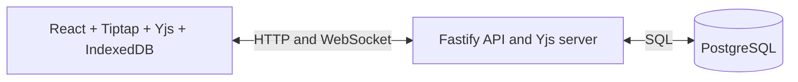

# SyncSpace

SyncSpace is a collaborative document workspace built with React, Tiptap, Yjs, Fastify, and PostgreSQL. The repository currently contains an MVP foundation and is under active implementation; it is not yet production-ready.

## Implemented

- React/Vite interface with sign-in and registration pages, document dashboard, and Tiptap editor.
- Fastify API with password hashing, hashed opaque sessions, HttpOnly cookies, CSRF tokens, Zod validation, rate limiting, document CRUD, soft deletion, and collaborator grants.
- PostgreSQL schema for users, sessions, workspaces, access grants, Yjs updates, and snapshot checkpoints.
- Yjs WebSocket sync using the `y-websocket` provider protocol, IndexedDB local persistence, room authorization, and read-only update rejection.
- Deterministic unit tests for concurrent Yjs edits, duplicate delivery, offline merge, and checkpoint replay; basic auth page tests.

## Architecture



The browser uses Yjs for optimistic edits and merge semantics. The API validates sessions and permissions. PostgreSQL stores metadata and Yjs updates. See [architecture](docs/ARCHITECTURE.md), [API](docs/API.md), [database](docs/DATABASE.md), and [security](docs/SECURITY.md).

## Local setup

Requirements: Node.js 20.12+, npm, and PostgreSQL 14+.

```powershell
Copy-Item .env.example .env
# Start PostgreSQL and set DATABASE_URL in .env
npm install
npm run db:migrate
npm run dev
```

The API listens on port 3001 and Vite on 5173. The server loads values from `.env` when present; variables already set in the process environment take precedence. Configure `WEB_ORIGIN` to the browser origin. Session IDs and CSRF tokens are generated with the system cryptographic random source and stored hashed or server-side.

## Commands

```powershell
npm run typecheck
npm test
npm run build
npm run db:migrate
```

## Configuration

See [.env.example](.env.example): `NODE_ENV`, `PORT`, `DATABASE_URL`, and `WEB_ORIGIN`.

## Status and known limitations

- The collaboration handler commits each Yjs update before applying it to the room or relaying it to peers. The standard provider protocol has no per-update durability acknowledgement, so the UI reports transport connectivity rather than a durable-save receipt.
- Snapshot compaction and replay code exist, but PostgreSQL recovery and compaction have not been exercised against a running database.
- Offline state uses IndexedDB and Yjs merge behavior; real browser reconnect and two-user WebSocket flows are not yet end-to-end verified.
- Sharing currently grants access to an existing SyncSpace account by email. Invitation emails are not sent.
- No Docker image, GitHub remote, registry publication, or deployment has been configured or verified.
- No performance benchmark has been run. See [benchmark plan](docs/BENCHMARKS.md).
- Dependency installation reported 36 advisories (33 moderate, 1 high, 2 critical); review the lockfile with `npm audit` before deployment.

Roadmap: [docs/ROADMAP.md](docs/ROADMAP.md).

## License

No license has been selected yet.

## Local Docker workflow

Docker Compose starts PostgreSQL and the production-built single-process app on port 3001. Its database password is for local development only.

```powershell
Copy-Item .env.example .env
docker compose up --build
```

Before starting, set a local-only `POSTGRES_PASSWORD` in `.env`. Open `http://localhost:3001`. The container runs migrations before serving. PostgreSQL data lives in the named `syncspace-postgres` volume. `.env` is ignored by Git; never commit it.

## Production container

The production Compose file expects an externally managed PostgreSQL URL and an immutable image tag. Put values in a protected environment file and configure a TLS reverse proxy with WebSocket upgrades.

```powershell
$env:IMAGE_NAME = "ghcr.io/OWNER/REPOSITORY"
$env:IMAGE_TAG = "sha-<commit>"
$env:DATABASE_URL = "<managed-postgres-url>"
$env:WEB_ORIGIN = "https://syncspace.example.com"
docker compose -f docker-compose.prod.yml up -d
```

GitHub Actions workflows for checks and GHCR publication are included; they run after the repository is pushed to GitHub and package write permissions are available. No image has been published yet.

