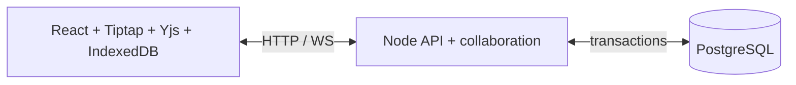
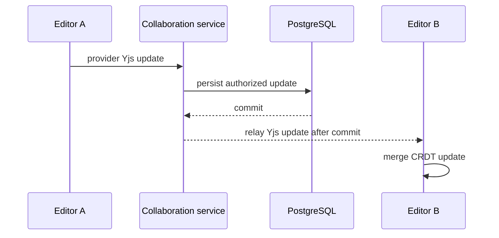
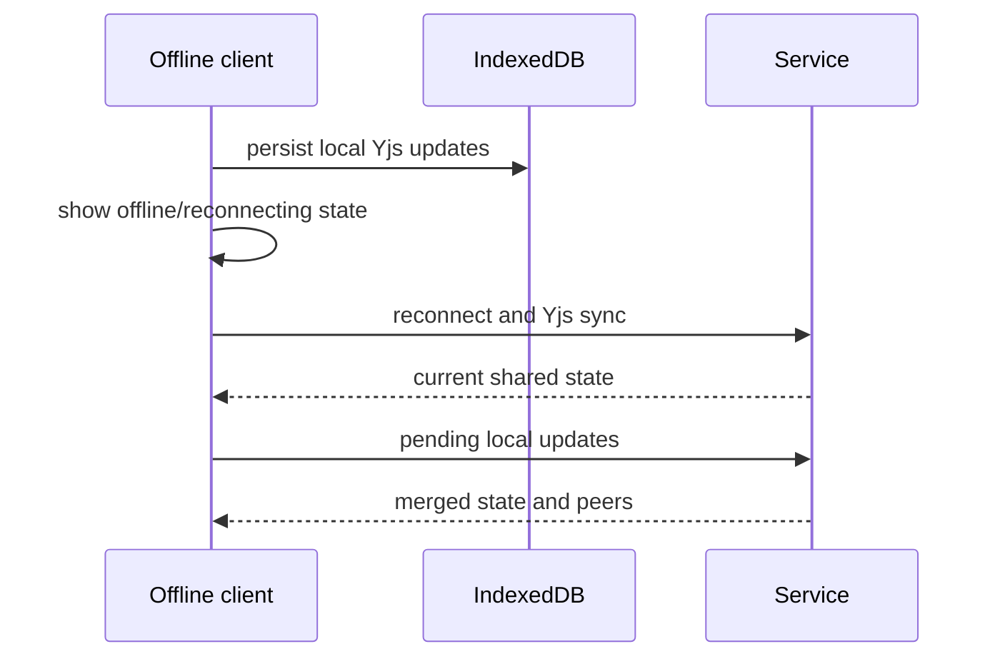
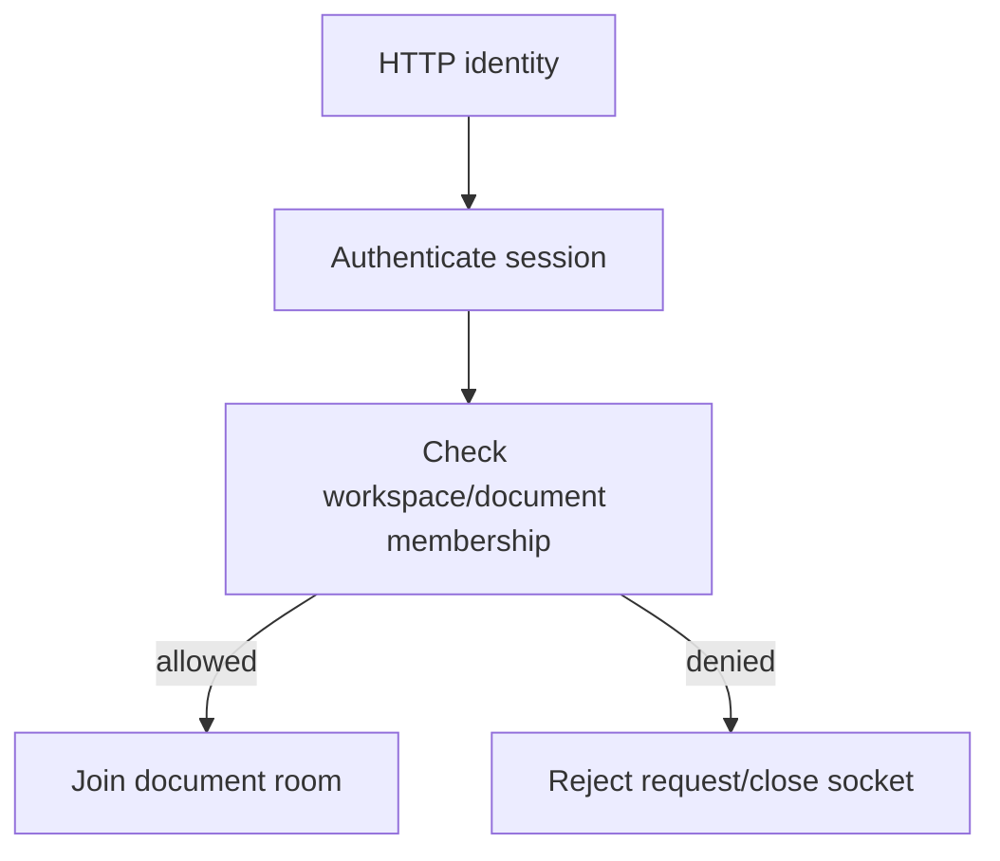
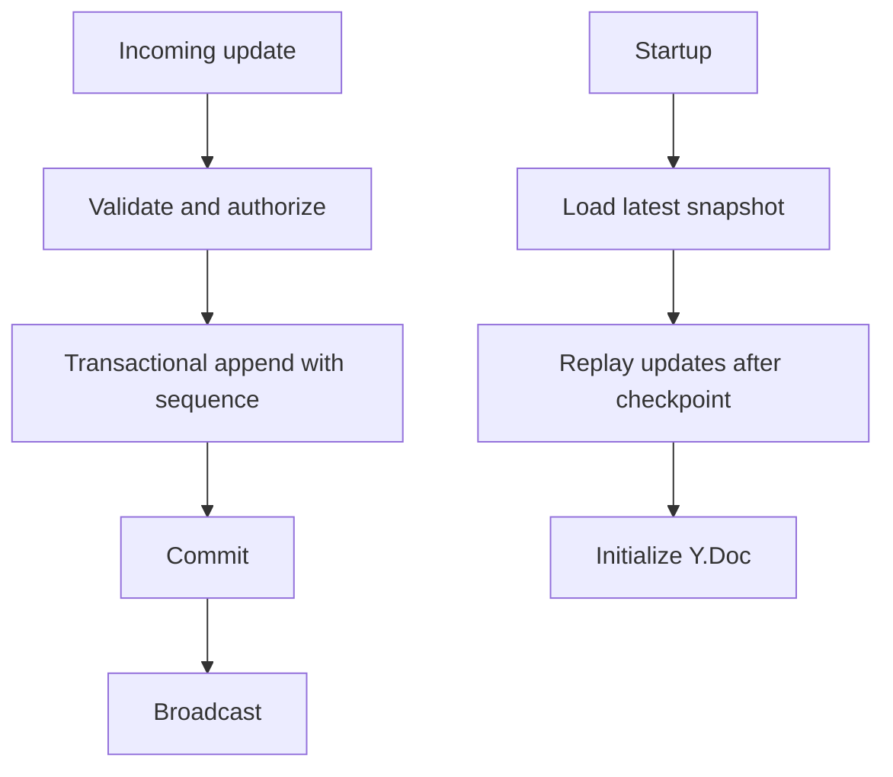

# SyncSpace Architecture

## Current design and status
The target topology is a Vite/React/TypeScript browser, a TypeScript HTTP and WebSocket service, and PostgreSQL. The client owns optimistic editing through Yjs; the service authenticates users, authorizes rooms, relays Yjs provider traffic, and persists durable updates. PostgreSQL is the recovery source. Deployment topology is not yet validated.

## Lifecycles
Document creation: authenticated request → membership check → transaction creates metadata → client opens authorized room → provider synchronizes state.
Editing: Tiptap transaction → Yjs update → provider sends update → server validates room membership and edit permission → server validates the Yjs update → serialized PostgreSQL transaction appends it and increments the document sequence → server applies the update to the room and relays it. A failed commit closes the connection without relaying the update, allowing the IndexedDB-backed client to retry after reconnect. Awareness/cursors remain ephemeral. The standard Yjs provider has no per-update durable acknowledgement; “Connected” describes transport only, while peers receive an update only after commit.
WebSocket: validate origin and session, authorize document before room join, synchronize provider state, relay updates/awareness, enforce size/rate limits, then remove awareness on disconnect.

## Responsibilities and consistency
Yjs resolves concurrent operations and merges updates idempotently; WebSockets transport updates and awareness but do not imply durability; PostgreSQL stores metadata and durable Yjs state. The intended model is eventual CRDT convergence with explicit persistence acknowledgement after commit. Presence is transient. Snapshot compaction must checkpoint a consistent update sequence and prune only updates covered by that checkpoint, in a transaction that serializes with appends.

Authentication uses server-validated sessions; HTTP and socket operations check access independently. Share changes and soft deletion close tracked active sockets so clients must reauthenticate and reauthorize on reconnect. Recovery loads a snapshot then replays updates beyond its checkpoint. Browser IndexedDB retains local state for reconnect. Development uses local services; production requires TLS, secure cookies, restricted origins, managed PostgreSQL, backup policy, and WebSocket-capable hosting. Persistence and restart recovery still require PostgreSQL integration testing before production readiness can be claimed.

## Diagram coverage
The diagrams above cover component architecture, editing, synchronization, offline reconnection, persistence/recovery, and authentication/authorization. Update this document as implementation choices become concrete.
